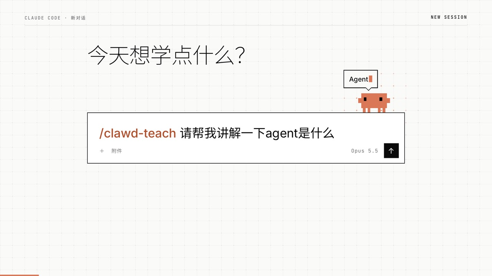
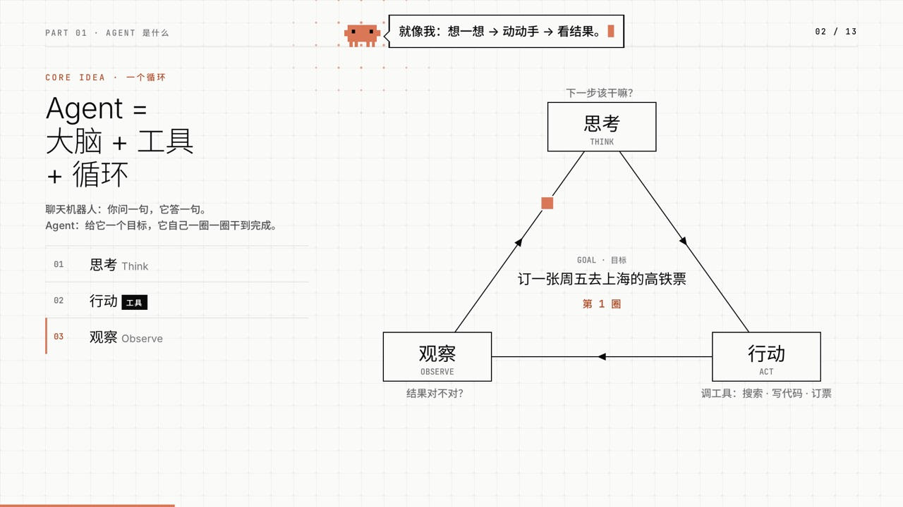
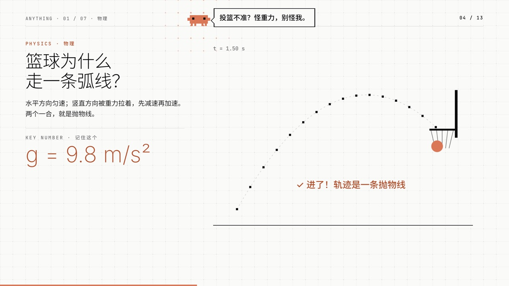

# clawd-teach

**让 Clawd 教你任何事情。** 一个 Claude Code skill：把任何主题变成一份会动的 HTML 课件 + 一份逐页台词，由橙色像素小助教 Clawd 一路陪讲、冷笑话管够。

*Turn any topic into a single-file, animated HTML lesson in Swiss "Style B", taught by Clawd, a funny pixel teaching assistant, plus a per-step teacher script.*



```
/clawd-teach 请帮我讲解一下 agent 是什么
```

| | |
|---|---|
|  |  |
|  |  |
|  |  |


## 你会得到

1. **一份动画课件**（单个 `.html` 文件）
   - 左右翻页，每按一下，内容就出现一步。
   - 核心概念都有 canvas 动画，比如：披萨切块拼成长方形、割线变切线、二分查找赛跑。
   - 直接用浏览器打开就能讲，不需要任何依赖。
2. **一份逐页台词**（`_台词.txt`）
   - 每一页、每一步讲什么，都写好了。
   - 包含 Clawd 的台词、互动提问和时间建议。
3. **一个搞笑助教 Clawd**
   - 会走路、蹦跶、流汗、挥手，在顶线上「站岗」。
   - 每一步都会冒出一句冷笑话，点它还会再讲一个。

风格是 Swiss Style B：
- 只用一个橙色 `#D97757`。
- 细字重的大字，无衬线字体。
- 没有圆角、阴影和渐变。
- 背景是点阵网格，鼠标附近会变橙。

## 安装

**Claude Code（推荐）**

```bash
git clone https://github.com/Haoskyfog/clawd-teach ~/.claude/skills/clawd-teach
```

装好后，用 `/clawd-teach` 调用。直接说「帮我做个课件讲讲 XX」也会自动触发。

**Claude App / claude.ai**：在 Releases 里下载 `clawd-teach.skill`，然后在 Claude 里点「Save skill」。

## 用法示例

```
/clawd-teach 给学生讲高数导论课，40 分钟
/clawd-teach 讲讲二分查找，给编程新手
/clawd-teach 为什么天空是蓝的？给初中生
```

课件操作：

| 按键 / 操作 | 作用 |
|---|---|
| `→` / `空格` | 下一步 |
| `←` | 上一步 |
| `F` | 全屏 |
| `H` | 隐藏或显示 Clawd |
| 点 Clawd | 讲冷笑话 |

## 目录

```
SKILL.md                    工作流程和质量标准（Claude 读这个）
assets/template.html        引擎 + 8 种页面骨架（封面 / 开场玩笑 / 概念 / 动画演示 / 卡片 / 章节 / 总结 / 路线图）
references/
  design-system.md          Swiss Style B 规则与组件
  clawd.md                  Clawd 的站位、动作和说话风格
  scenes.md                 canvas 动画写法与踩过的坑
  script-format.md          台词稿格式
scripts/check_deck.py       静态检查：漏写台词、占位符、违反风格等
examples/
  calculus-intro.html       16 页「高数导论课」（专升本）+ 台词
  binary-search.html        8 页「二分查找」+ 台词
```

检查一份课件：

```bash
python3 scripts/check_deck.py 你的课件.html
```

## 说明

- Clawd 是 Anthropic 的吉祥物形象。本项目是粉丝自制的教学工具，与 Anthropic 没有关联。
- 字体通过 Google Fonts 加载（Inter / Noto Sans SC / JetBrains Mono）。加载失败时，会自动回退到系统无衬线字体。

## License

[MIT](LICENSE)
